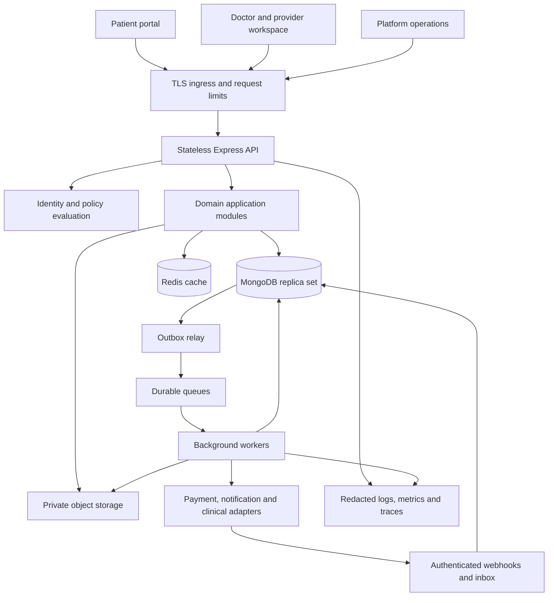

# High level and low level architecture

## Deployment and trust boundaries

Start with one versioned Express API and separately scalable workers from the same codebase. MongoDB is the authoritative store; Redis supports queues, caches, and rate limits. S3 stores private clinical files and a separate public-media area. Adopt a replica-set deployment before using transactions. Introduce separate services only when team ownership, workload, or security boundaries justify them.



Use private network access for database and Redis, least-privilege service identities, encryption in transit and at rest, managed secrets, and backups independently protected from application credentials. Cache and queue deployments may share infrastructure initially, but use separate Redis instances when eviction policies or operational loads differ. Do not let cache eviction remove queued jobs.

## Tenant and identity model

`organizationId` is the provider's data boundary. A hospital group can own multiple facilities inside one organization only when the contracted custody/access arrangement permits it. A corporate parent relationship is organizational metadata, not permission to see every subsidiary's records. Separate legal providers normally get separate organizations.

| Entity                 | Meaning                                                                                                   |
| ---------------------- | --------------------------------------------------------------------------------------------------------- |
| `users`                | Login principal; one person may be patient, doctor, and administrator in different contexts               |
| `patients`             | Protected platform patient identity; no mandatory login; not searchable by arbitrary provider staff       |
| `patientRegistrations` | An organization's local patient record, MRN, demographic snapshot, registration status                    |
| `practitioners`        | Professional identity shared across workplaces; includes nurses and allied clinicians                     |
| `doctors`              | Doctor-specific public and professional profile linked to a practitioner                                  |
| `memberships`          | User's staff status and permitted facility scope within an organization                                   |
| `roleAssignments`      | Permission bundle in a particular platform, organization, or facility context                             |
| `doctorAffiliations`   | Verified professional relationship with a facility; not itself login permission                           |
| `serviceOfferings`     | A specific bookable service at a facility, optionally by a doctor, with mode, duration and pricing policy |

A global patient ID is a private linkage mechanism, not a global medical record that every tenant can query. A registration can initially point to an unclaimed patient identity. Do not automatically merge records based on name, phone, email, or date of birth. Verified patient linking and merge review preserve source IDs and audit evidence. Provider users see their own registration snapshots; patient-mediated access can assemble a timeline from several custodians.

Clinical records require `organizationId`, `patientId`, and `patientRegistrationId`. Services assert these all agree and validate referenced facility, encounter, prescriber, and order within the same custody boundary. Patient-owned uploads and self-reported records use a separate explicit custody discriminator; missing `organizationId` must never mean public access.

## Modules and ownership

| Module               | Owns                                                                                  | Calls through interfaces                     |
| -------------------- | ------------------------------------------------------------------------------------- | -------------------------------------------- |
| Identity             | Users, identities, sessions, challenges, MFA                                          | Notification delivery, audit                 |
| Access               | Memberships, roles, assignments, policy evaluation                                    | Consent and patient relationships            |
| Provider             | Organizations, facilities, practitioners, qualifications, registrations, verification | Identity, catalog, documents                 |
| Patient              | Identity registry, local registration, authorized representatives, identity merge     | Access, audit                                |
| Catalog              | Terminology, specialties, questionnaires, service and drug definitions                | Clinical governance review                   |
| Discovery            | Public doctor/facility projection, reviewed routing rules, reviews                    | Provider, schedule query API                 |
| Scheduling           | Recurrences, exceptions, resource calendars, slots and reservations                   | Provider eligibility                         |
| Booking              | Appointment lifecycle, cancellation and reschedule policies, queue entries            | Scheduling commands, patient access, pricing |
| Clinical             | Visits, encounters, findings, notes, care plans, signatures and revisions             | Patient access, provider eligibility         |
| Prescribing          | Prescription and item lifecycle                                                       | Clinical, drug catalog, signatures           |
| Diagnostics          | Orders, specimens, results, diagnostic reports, result follow-up                      | Clinical, integration adapters               |
| Billing              | Charges, invoices, allocations, credits, ledger                                       | Booking and clinical events                  |
| Payments             | Provider attempts, webhooks, refunds, disputes, reconciliation                        | Billing, payment adapter                     |
| Marketplace commerce | Provider contracts, plans, subscriptions, commissions, settlement                     | Billing and payment interfaces               |
| Documents            | Upload intents, custody, immutable file versions, scanning and access                 | Access policy, object storage                |
| Privacy              | Notices, consent, grants, rights requests, retention and holds                        | Audit, document and clinical queries         |
| Operations           | Notifications, tasks, support, messaging, integration inbox/outbox                    | Explicit domain commands                     |
| Hospital             | Admission, bed allocation, nursing, dispensing, stock, claims                         | Clinical, billing, scheduling                |

A module cannot import another module's Mongoose model to modify its documents. Cross-module orchestration invokes application interfaces with a shared unit-of-work when strong consistency is required. Cross-module read projections may join data through dedicated, policy-aware query services. This is lightweight CQRS: different command and query paths, one authoritative database initially.

## Express request flow

1. Ingress limits request size and connections; assign a request/correlation ID.
2. Webhook routes capture raw request bytes before JSON parsing and verify provider authenticity. Normal routes parse bounded JSON.
3. Authenticate principal and session, resolve current role assignments, organization/facility context, and authentication strength.
4. Validate a strict DTO. Derive tenant scope from authorized context; treat client IDs as requested resources only.
5. Apply permission, relationship, custody, purpose, consent/legal-basis, and resource-state policies.
6. Execute a command or query. Commands enforce invariants in domain services and conditional repository operations.
7. Commit aggregate changes plus audit/outbox records where required.
8. Present an allowlisted response. Translate expected conflicts and validation failures into stable error codes.

Express supports promise-based error propagation, but timer callbacks, workers, and other detached work still require explicit error handling. Keep a final error middleware that removes stack traces and sensitive values from production responses. [Express error handling](https://expressjs.com/en/guide/error-handling/).

## Proposed organization of future code

This is a folder design only; these files are not created by this work.

```text
src/
  app.ts                         HTTP composition only
  server.ts                      Lifecycle, shutdown, connections
  config/                        Validated configuration
  shared/
    application/                 ActorContext, UnitOfWork, clock, IDs
    domain/                      Money, CodeableConcept, Period, errors
    infrastructure/              DB connection, outbox relay, telemetry
  modules/
    booking/
      http/                      Routes, DTOs, controllers, presenters
      application/               Hold, confirm, cancel, reschedule, queries
      domain/                    State machine, cancellation policy
      persistence/               Schemas, repositories, index definitions
      public.ts                  Supported module interface
    identity/ provider/ patient/ scheduling/ clinical/ billing/ ...
  integrations/                  Payment, storage, FHIR, LIS, PACS adapters
workers/                         Queue processors and recovery sweepers
migrations/                      Resumable data and index changes
tests/                           Domain, integration, concurrency, security
```

Keep simple catalog CRUD simple. Rich domain objects and repositories are useful for bookings, clinical signing, financial allocation, and inventory because those aggregates have meaningful invariants. Avoid creating four empty abstraction layers for every lookup table.

## Main collaborating components

| Component                   | Contract and responsibility                                                                                                |
| --------------------------- | -------------------------------------------------------------------------------------------------------------------------- |
| `ActorContext`              | User/service ID, session, membership, authorized org/facilities, purpose, request ID, authentication level                 |
| `PolicyService`             | `authorize(actor, action, resource)` returns an auditable decision; never accepts tenant scope from the caller unchecked   |
| `BookingApplicationService` | Validates request, quotes, authorization and eligibility; coordinates reservation, booking, invoice/payment intent         |
| `AvailabilityService`       | Reads recurrence and exceptions; acquires/relinquishes claims through the calendar locking protocol                        |
| `UnitOfWork`                | Starts/retries one MongoDB transaction; passes a session to all repositories; no external network calls inside             |
| `ClinicalSigningService`    | Validates credentials, draft version, required content and review checks; seals revision and signature evidence atomically |
| `BillingService`            | Calculates deterministic amounts and rounding, issues invoices, allocates payments and credits                             |
| `PaymentAdapter`            | Creates provider order, verifies webhook, fetches status, refunds and reconciles using provider-specific capabilities      |
| `OutboxPublisher`           | Leases pending events, publishes, retries; publication may repeat after crash                                              |
| `ProjectionHandler`         | Deduplicates event and applies only newer aggregate versions; can rebuild from authoritative data                          |
| `DocumentAccessService`     | Authorizes each request, audits issuance, returns version-specific short-lived access                                      |

Dependency direction is HTTP -> application -> domain. Infrastructure implements narrow interfaces. Composition uses explicit factories/dependency injection at the application root; a framework container is optional.

## Consistency and event policy

Strong consistency: resource claims and appointments; clinical seal plus signed revision; issued invoice totals; payment allocations; refund reservations; ledger journal balance; dispensing plus stock deduction; bed occupancy transfer. Use majority-durable writes and bounded transactions for these operations.

Eventual consistency: search, reminder delivery, PDFs, analytics, external exports and dashboard caches. Show `asOf`/processing status where staleness matters. Search cannot authorize a booking; the authoritative booking path rechecks doctor verification, affiliation, price, facility state, and reservations.

Persist outbox events in the same transaction as the business state. Workers deduplicate using `eventId + consumer`. External API calls occur after commit and use provider idempotency where available. A crash after an external effect but before local acknowledgement remains possible; reconciliation closes this gap. Do not promise exactly-once message delivery. [BullMQ retry-safe jobs](https://docs.bullmq.io/patterns/idempotent-jobs).

## Architecture decisions

| ADR | Decision                                                          | Tradeoff / trigger to revisit                                                                                |
| --- | ----------------------------------------------------------------- | ------------------------------------------------------------------------------------------------------------ |
| 001 | Express modular monolith                                          | Fast coherent transactions; extract modules when measured load or team boundaries require it                 |
| 002 | Shared MongoDB with mandatory tenant predicates                   | Operational simplicity; dedicated databases can be offered for isolation contracts                           |
| 003 | Protected global patient/practitioner identity with local custody | Supports cross-provider portals; requires strict linking and privacy boundaries                              |
| 004 | Small embedded values, referenced lifecycle records               | More joins than a giant patient document, but bounded records and clear ownership                            |
| 005 | Calendar serialization plus interval claims                       | Handles different appointment durations and cross-clinic collisions; adds contention on busy resource days   |
| 006 | Signed typed snapshots plus current resource heads                | Convenient current reads and immutable evidence; more storage and explicit correction commands               |
| 007 | Transactional outbox/inbox                                        | At-least-once delivery requires dedupe and operational recovery                                              |
| 008 | Provider-scoped merchant configuration                            | Allows gateway-approved collection models; commercial/legal choice remains explicit                          |
| 009 | FHIR adapter, not FHIR as every internal document                 | Requires mapping tests but preserves internal workflow clarity                                               |
| 010 | Financial subledger in MongoDB initially                          | Requires rigorous accounting invariants; integrate/export to accounting rather than invent a complete ERP    |
| 011 | No offline clinical writes in first release                       | Avoids unsafe synchronization; hospital launch still needs documented downtime procedures                    |
| 012 | Provider subscription cannot erase records or bypass care policy  | Entitlements control commercial features while retention/export and safety operations follow contract/policy |

## Existing repository fit

The current code has Express, strict TypeScript, Zod, Mongoose, sessions, roles, email, storage, assets, and a blog. Reuse infrastructure after review. The current user model contains a single global `role`; the proposed membership and assignment model needs a deliberate compatibility migration. Preserve existing user IDs and password hashes.

The current public asset library defaults to public visibility and stores URLs. It is suitable for website imagery, not clinical reports. Build a private clinical document boundary on top of the storage adapter. Do not apply image optimization to diagnostic source files. Existing file ownership is user-based; patient/organization custody, scan state, retention, and per-access policies must be added in the clinical document module.

Current global JSON parsing will need a route-specific raw-body arrangement for signed payment webhooks. CORS allowlists will need the approved idempotency/version headers. These are implementation tasks, not changes made by this design.
