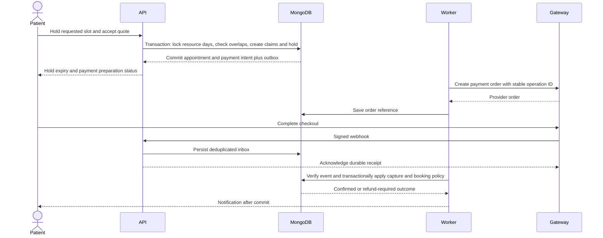

# Business workflows and consistency rules

## Provider onboarding and professional profiles

1. A user verifies an account and chooses hospital, clinic, or independent practice onboarding.
2. Create a draft organization, owner membership, facilities and legal/contact details. A solo doctor gets a solo-practice organization and a consultation location or virtual facility.
3. Create/link the practitioner's private identity and doctor's public profile. Record qualifications, training, dated employment, registrations, languages, specialties, and supporting evidence separately.
4. Verify professional registration, organization evidence and the user's authority to represent the provider. Record reviewer, evidence version, decision, reasons and revalidation date. Self-approval is prohibited.
5. The organization invites staff with time-bounded roles and facility scope. Joining a hospital and proving medical credentials are separate steps.
6. Create verified doctor affiliations and service offerings: consultation mode, duration, buffers, fees, tax classification, cancellation policy and payment mode.
7. Publish schedules only after required verification and facility activation. Public profiles expose business addresses and approved credentials; residential addresses, evidence files and identity documents stay private.
8. Suspension or credential expiry blocks new booking/prescribing as applicable. Existing appointments generate a reassignment/cancellation work queue; never silently discard them.

Organization: `DRAFT -> UNDER_REVIEW -> ACTIVE`; review can request changes or reject. `ACTIVE -> SUSPENDED -> ACTIVE` requires review; `ACTIVE/SUSPENDED -> OFFBOARDING -> CLOSED` retains required records. Doctor verification and affiliation have independent effective dates.

## Patient registration, dependent access and identity

Self-registration creates a user and optional claimed patient identity. Provider registration creates an organization-scoped MRN and snapshot; login is optional. A guardian account can act for several patients through verified relationships with explicit actions and validity. Being an emergency contact is not authorization to read records.

Store name, date-of-birth precision or estimated age, administrative sex where necessary, separately recorded gender identity when relevant, languages, addresses, accessibility requirements and contacts. An emergency patient may have a temporary identity; later reconciliation is reviewed. Never manufacture a birth date from an approximate age without marking it estimated.

Potential duplicate detection suggests candidates to authorized staff. A merge requires evidence and review, canonical survivor ID, alias mapping, collision checks for local MRNs, and a reversible provenance trail. Do not mass-rewrite historical signed snapshots; resolve current identity through verified links while preserving the original identifiers.

## Discovery and intake

Patient chooses a concern or specialty, location, language, mode and time. An optional versioned questionnaire records answers, duration and patient-reported concerns. Reviewed routing rules suggest specialties, with version and reviewer provenance. This is routing assistance, not automated diagnosis. Clinically governed urgency messaging must be evaluated separately from ranking.

Candidate retrieval uses active verified provider projections. Rank by service fit, geography, availability and transparent product rules; paid placement is distinctly labeled. Do not use private clinical histories for marketing ranking by default. Rates and availability shown in search are estimates until an authoritative quote and hold succeed.

Patient intakes remain private drafts until explicitly submitted to an organization/appointment. A changed answer after submission is a new version or follow-up submission, not a silent alteration of what the doctor originally reviewed.

## Booking and payment sequence

Gateway creation can be synchronously attempted after commit for a faster checkout, but must use the same persisted operation and recovery path. A gateway timeout is an unknown outcome, not proof of failure.

### Reservation algorithm

Use real resource intervals, not merely unique slot start times. Each doctor's practitioner resource is global across organizations; rooms and devices are organization-owned resources. Claim the consultation interval plus configured preparation/travel/cleanup buffers.

1. Validate current organization, facility, affiliation, credential, offering, submitted quote, patient actor permission and request idempotency.
2. Determine every resource and UTC calendar day touched by the buffered half-open interval `[startAt, endAt)`. Overnight reservations touch more than one day.
3. Ensure one persistent `resourceCalendarDays` document exists for each resource/day. First-use creation uses its unique key and retries duplicate inserts.
4. Begin a transaction. Write/increment those documents in deterministic resource/day order. This creates a shared write-conflict point for concurrent commands.
5. Query overlapping active claims: `existing.startAt < requested.endAt AND existing.endAt > requested.startAt`. `HELD` counts only while its authoritative expiry is still future; `CONFIRMED` counts until released. Compute time on the trusted server/database boundary, never from the browser.
6. If no conflicts exist, create the booking, token-bound claims, pricing/policy snapshots, history and outbox; commit. Every create, confirm, release, reschedule and material schedule change must use the same calendar protocol.
7. On write conflict, retry the complete transaction with bounded backoff and rerun all checks. On booking conflict return `SLOT_UNAVAILABLE`.

The common calendar write is essential: two transactions that only read for overlaps and insert different claims can otherwise both succeed. Resource-day documents are serialization anchors, not Redis leases. The database owns correctness. This is a proposed algorithm to validate with real replica-set concurrency tests before launch. [MongoDB atomicity](https://www.mongodb.com/docs/manual/core/write-operations-atomicity/).

For initial doctor consultations use capacity one. Multi-resource bookings claim all resources atomically. Group sessions and pooled capacity require a separate reviewed capacity model; they must not be enabled by simply setting an arbitrary slot capacity greater than one.

### Expiry, confirmation and late capture

Appointment hold and all claims share a random hold token and expiry. A sweeper expires only a matching token and expected state/version. Booking/confirmation checks expiry even if the sweeper is late. No TTL deletion of holds, claims or appointments is used for business logic. [TTL timing](https://www.mongodb.com/docs/manual/core/index-ttl/).

Payment capture confirms only the still-valid corresponding hold, matching patient/merchant/currency/amount and approved payment policy. If capture arrives after expiry or cancellation, record the real capture and create `REFUND_REQUIRED` operations work; do not resurrect a booking or evict a newer claimant. An optional grace policy must be explicit, resource-checked and consistently applied; default is no automatic resurrection.

For pay-at-clinic or zero-price services, confirm after eligibility and reservation checks without requiring an online capture. `paymentStatus` never controls clinical arrival directly.

## State machines

| Aggregate           | Allowed progression and exceptions                                                                                                                                             |
| ------------------- | ------------------------------------------------------------------------------------------------------------------------------------------------------------------------------ |
| Appointment         | `HELD -> CONFIRMED / EXPIRED / CANCELLED`; `CONFIRMED -> CHECKED_IN / CANCELLED / NO_SHOW`; `CHECKED_IN -> IN_PROGRESS / CANCELLED`; `IN_PROGRESS -> COMPLETED / DISCONTINUED` |
| Walk-in appointment | Created `CONFIRMED` only after explicit capacity/overbooking policy, or skip appointment and create visit/queue entry                                                          |
| Visit               | `OPEN -> CLOSED`; entered-in-error is a reviewed correction, not routine deletion                                                                                              |
| Encounter           | `PLANNED -> IN_PROGRESS -> FINISHED`; `PLANNED -> CANCELLED`; clinical content may remain pending signature after care ends                                                    |
| Clinical content    | `DRAFT -> SIGNED`; post-sign correction produces a new revision/addendum or entered-in-error annotation with original preserved                                                |
| Payment attempt     | `CREATED -> PENDING -> AUTHORIZED -> CAPTURED`; provider may skip intermediate states; failure/cancellation applies only with trustworthy final evidence                       |
| Refund              | `REQUESTED -> PROCESSING -> SUCCEEDED / FAILED`; failures may be retried under the same operation identity                                                                     |
| Invoice             | `DRAFT -> ISSUED`; draft may be discarded; issued correction through credit/debit documents; payment progress derived from allocations                                         |
| Document            | `PENDING_UPLOAD -> QUARANTINED -> SCANNING -> AVAILABLE / REJECTED`; failed scan is not available; archive/delete follow retention workflow                                    |

No generic `PATCH status` endpoint. Commands have allowed actors, expected prior state/version, required reason, timestamps, side effects, and an audit event. Appointment completion indicates care workflow completion; signed clinical records remain independently governed. A case ending after care begins is discontinued with its clinical record retained, not treated as a consultation that never existed.

### Cancellation, reschedule, leave and queues

Cancel in a transaction with resource release, history, and refund obligation computed from the accepted policy snapshot. Refund failure does not reverse cancellation. Receptionist cancellation requires delegated authority and reason.

Reschedule reserves new resources and releases old resources in one transaction, validating the original version. Retain the appointment ID and record before/after offering, facility, time, claim IDs, and policy/price differences in history. Reject once care has started. Additional charges require a new payment intent; reduced price creates an explicit credit/refund path.

Doctor leave blocks new availability and creates a worklist for affected appointments. Do not regenerate away booked slots. Queue check-in assigns an organization/facility/day token; priority changes are audited and do not falsify appointment times. Waitlist offers are time-limited, owned, and acquired through the same reservation protocol.

## Clinical visit and record workflow

1. Staff verify the patient and local registration; open visit, queue and encounter as appropriate.
2. Authorized care team reads a current summary with source, time and review status. Absence of allergy data is `UNKNOWN`, not `NO_KNOWN_ALLERGIES`.
3. Record triage, vitals, histories, allergies, medication reconciliation, clinical findings and diagnoses with author/source and effective time.
4. Create requests for tests, referrals, procedures and medications. An order is not proof the procedure or dispense occurred.
5. Prescriber reviews allergies/medications and any governed decision support. Medication rules require clinician/pharmacist validation; this design supplies data structures, not dosing advice.
6. Signing checks current credential/affiliation, author permissions, expected draft revision, required fields and acknowledgement rules. Commit immutable typed revision, signature evidence and publication event together.
7. Patient release follows record-specific policy; publish prescription/summary after successful seal. Generate a PDF asynchronously from the signed snapshot, retaining hash and source revision.
8. Follow-up tasks track assigned owner, due date and acknowledgement. A result notification being sent does not prove the clinician reviewed it.

Current clinical heads support workflow status. `clinicalRevisions` is the immutable source for signed content. A correction references the prior revision and reason; amended reports alert prior recipients where policy requires. A medication discontinuation event does not rewrite the original prescription.

## Orders, laboratory, radiology and pharmacy

Order -> specimen collection/accession -> receipt/rejection/recollection -> test execution -> observations -> verified report -> critical-result task -> clinician acknowledgement. Patient, order, specimen and result links must be validated at every handoff. Preserve external message IDs and unit/reference-range provenance. Imported OCR text is an unverified extraction until reviewed.

Imaging order -> scheduled modality -> study UID/PACS reference -> radiologist report -> clinician review. Source diagnostic images remain unmodified. PDF attachment metadata does not replace imaging study metadata.

Prescription item -> pharmacist validation -> batch selection -> partial/full dispense -> stock movement -> billing. Returns record provenance and disposition; returned drugs do not automatically become saleable stock. Medication administration records actual dose/time/route/performer and omissions, independently of dispensing.

## Admission, transfer, nursing and discharge

Admission request or emergency arrival -> registration/triage -> inpatient visit -> bed assignment -> care team/orders -> nursing tasks and medication administration -> transfer if needed -> discharge readiness -> signed discharge summary and medicine reconciliation -> physical discharge/bed cleaning -> final billing and payer follow-up.

Bed assignment and transfer atomically update active occupancy; a patient cannot occupy two active beds by accident and a bed cannot have two patients. Model clinical discharge, physical departure, room cleaning and financial closure separately. Unpaid balance is an administrative state, not an invented clinical state. Emergencies and downtime require provider-approved procedures.

## Finance and marketplace operations

Quote snapshots fix offered price, cancellation terms, currency and fee rules for booking. Clinical services create deduplicated charge items. Invoice issue freezes seller/buyer identity, numbered lines, rates, taxes, rounding and totals. Use currency minor units and exact arithmetic.

One payment can fund several invoices; one invoice can have multiple payments. `paymentAllocations` is the linking authority. Available captured amount is reduced by allocations/refund reservations under a transaction and version check. A refund has its own operation and allocation references; cumulative successful plus reserved refunds cannot exceed refundable captured funds. Credit notes correct liability; refunds move money. These are different operations.

For already allocated funds, a refund workflow explicitly reverses the relevant allocation or applies an approved credit and refund accounting treatment in the same guarded local operation. Maintain `captured >= netAllocated + refunded + refundReserved` for the simple direct-merchant model; invoice outstanding is `issuedTotal - issuedCredits - netAppliedAllocations`. Reject unintended negative balances and reconcile caches to allocation/reversal records. Different gateway collection-agent accounting must define equivalent entity-specific equations before activation.

Marketplace commission is calculated from the contracted, versioned rule and recorded separately from gateway fees and provider net amounts. Settlement waits for capture, maturity, provider verification, cancellation/refund exposure and approved hold policy. A reversal creates compensating ledger entries and settlement adjustments; never edit a posted journal.

Provider subscription -> entitlement period -> provider invoice -> payment/renewal -> grace/suspension policy. Commercial feature restrictions must not erase retained clinical records or prevent required export. Booking fees, provider fees, taxes, discounts, refunds and disputes require an approved finance policy. A gateway's split-payment product is a capability, not automatic approval for DocDuniya's business model. [Razorpay Route](https://razorpay.com/docs/payments/route/).

## Consent, documents and offboarding

Record sharing selects patient, recipient, purpose, data categories/specific records, time range and expiry. Grant creation records authority/evidence; evaluation checks current consent/grant state each time. Withdrawal prevents future consent-dependent access and invalidates caches; it does not automatically delete records a provider must lawfully retain. Already downloaded copies cannot be recalled.

Upload authorization creates a pending document and random object key in quarantine. Server verifies object version, content length, checksum, file type and scan result; do not trust the browser's complete-upload message. Promote the exact scanned immutable version to available storage. Deny reads before availability. Audit URL issuance and storage access separately; a presigned URL is usable until it expires unless access is invalidated at the storage layer. [S3 access behavior](https://docs.aws.amazon.com/AmazonS3/latest/userguide/using-presigned-url.html).

Offboarding stops new service activity, resolves appointments/financial balances, exports authorized records with manifests, revokes memberships/integration credentials, and follows legal retention/holds. Deleting a login is never a cascade delete of clinical or financial history.
