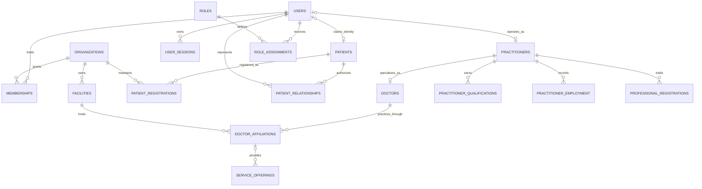
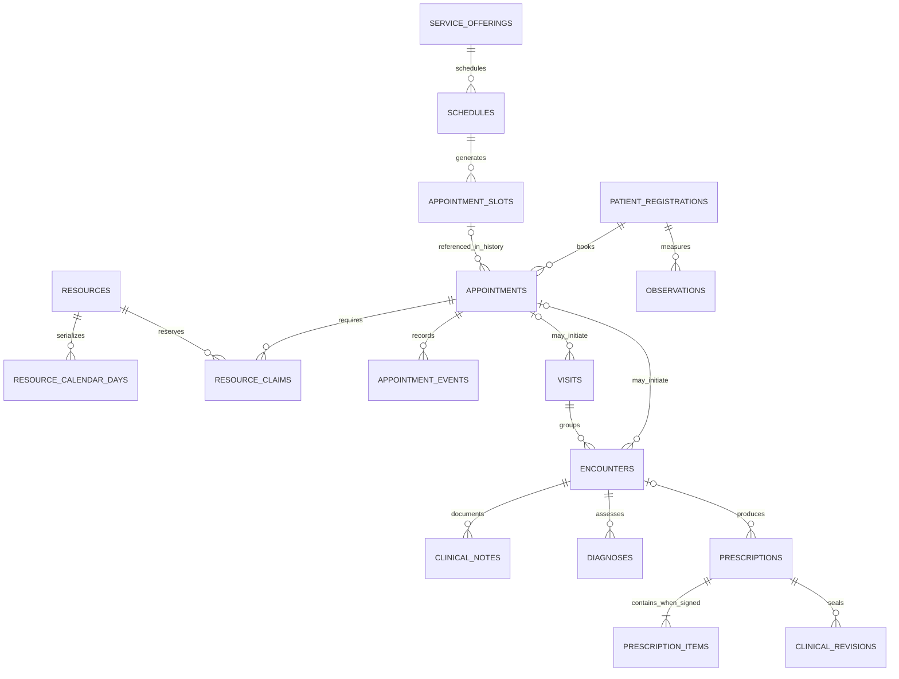
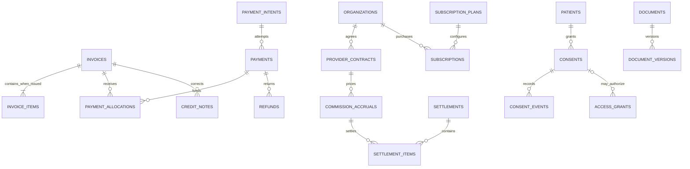
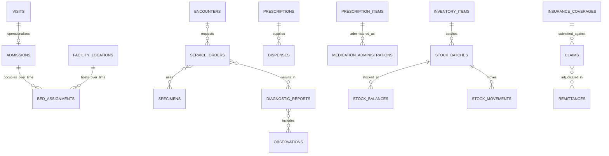

# Relationships, indexes and Mongoose conventions

## Relationship model

The diagrams show logical relationships. The dictionaries decide which entities are physical collections and which are embedded values. MongoDB references do not enforce foreign keys; domain commands enforce existence, tenant, patient, effective dates and allowed lifecycle.

Optional login links mean a patient/practitioner may have zero users; the `claims_identity` and `operates_as` edges describe the linked subset. The authoritative cardinality is `patients.ownerUserId?` and `practitioners.userId?`, each unique when present. An account's authorized dependent patients are reached through patientRelationships, not by reusing ownerUserId.

A slot can appear in historical cancelled/expired bookings and a later successful booking; do not place an unconditional unique index on `appointments.slotId`. Active resource claims enforce occupancy. A multi-step reschedule creates new claim records and retains released old ones. An encounter without an appointment is valid; an appointment can generate several encounters. Clinical revisions support other resource types as well as prescriptions.

## Physical embedding and deletion decisions

| Information                                     | Storage choice                                         | Reason and limits                                                                                                            |
| ----------------------------------------------- | ------------------------------------------------------ | ---------------------------------------------------------------------------------------------------------------------------- |
| Current addresses, contacts, emergency contacts | Bounded profile values                                 | Read with profile; profile audit/history preserves changes; separate address registry only when independent workflow emerges |
| Weekly schedule rules                           | Bounded schedule subdocuments                          | Validated together with effective dates and timezone                                                                         |
| Qualifications, employment, registrations       | Separate                                               | Independent evidence, reviewers, validity and history                                                                        |
| Specialty references                            | Bounded ID arrays                                      | Small stable set; references validated and inactive specialties retained historically                                        |
| Clinical history, appointments, audit, messages | Separate records                                       | Unbounded growth and independent access/retention                                                                            |
| Prescription medication lines                   | Separate stable items; embedded in signed snapshot     | Dispensing and administration need line references; signing seals the whole prescription                                     |
| Invoice lines                                   | Separate; issue locks parent and all lines             | Charge reconciliation and item-level crediting; immutable after issue                                                        |
| Ledger entries                                  | Bounded within journal                                 | One atomic balanced accounting unit; no infinitely growing account transaction array                                         |
| Binary files                                    | Object storage; immutable metadata versions in MongoDB | Scoped access, scanning, restore and retention                                                                               |
| Public search profile                           | Denormalized projection                                | Rebuildable, no private fields; current eligibility checked elsewhere                                                        |

Retire catalogs and providers without deleting referenced history. Restrict deletes while dependent clinical/financial records exist. Reviewed retention disposal is a separate command with hold checks and audit, including object-storage and search copies. Account removal revokes access and minimizes account data where permitted; it does not orphan author identities in signed records.

## Query-driven indexes

The collection dictionaries specify initial indexes for every collection. These are the most consequential query contracts:

| Query / invariant                     | Index or mechanism                                                                                                                                 |
| ------------------------------------- | -------------------------------------------------------------------------------------------------------------------------------------------------- |
| Lookup login identity                 | Unique `{issuer:1, subjectNormalized:1}` on authIdentities                                                                                         |
| One claimed personal patient per user | Unique `{ownerUserId:1}` with partial filter `{ownerUserId:{$type:'objectId'}}`                                                                    |
| Staff in organization                 | Unique `{organizationId:1,userId:1}` on memberships                                                                                                |
| Local MRN lookup                      | Unique `{organizationId:1,mrn:1}`; independent unique org/patient link                                                                             |
| Current doctor affiliation            | Unique `{organizationId:1,doctorId:1,facilityId:1}` with partial filter `{status:'ACTIVE'}`; commands reject overlapping periods before activation |
| Doctor day list                       | `{organizationId:1,doctorId:1,startAt:1,status:1}`; verify alternative status/start order against actual filter usage                              |
| Patient upcoming/history              | `{patientId:1,startAt:-1,_id:-1}` on appointments, queried through patient authorization; tenant dashboard adds org predicate                      |
| Reservation conflict check            | `{resourceId:1,state:1,startAt:1,endAt:1}` plus resource-day transaction anchors; unique indexes alone cannot exclude overlapping intervals        |
| Patient clinical timeline             | Per clinical collection `{organizationId:1,patientId:1,effectiveAt:-1,_id:-1}` where effectiveAt exists; use recordedAt/startedAt for other types  |
| Work queue                            | `{organizationId:1,status:1,dueAt:1,_id:1}` on tasks                                                                                               |
| Duplicate gateway callback            | Unique `{source:1,sourceAccount:1,externalEventId:1}` on inboxEvents                                                                               |
| Duplicate captured payment            | Partial unique `{merchantAccountId:1,providerPaymentId:1}` on payments where providerPaymentId is a string                                         |
| HTTP retries                          | Unique `{scopeKey:1,actorId:1,route:1,key:1}` on idempotencyKeys                                                                                   |
| Ledger effect dedupe                  | Unique `{organizationId:1,operationKey:1}` on ledgerJournals                                                                                       |
| Bed occupancy                         | Two partial unique indexes with `{active:true}`: org/bed and org/admission                                                                         |
| Nearby approved facilities            | `2dsphere` on valid GeoJSON location; filter visibility/verification; combine search engine support or staged query with measured plans            |

Partial uniqueness applies only to records matching its filter. Reject empty-string placeholders and invalid nulls instead of accidentally bypassing constraints. Do not combine `sparse` and `partialFilterExpression` for a single index. [MongoDB partial indexes](https://www.mongodb.com/docs/manual/core/index-partial/).

TTL is only for disposable operational data after a defined retention period: consumed challenges and expired sessions, optionally finished retry-key records. Use a separate `purgeAt` when evidence must remain after operational expiry. Financial dedupe, audit, clinical records, holds and stock reservations cannot be casually TTL-deleted. Partial indexes cannot express a moving `now`; expiry requires an explicit comparison in commands.

## Mongoose implementation contract

1. Future schemas use explicit collection/model names and strict TypeScript types. `Schema.Types.ObjectId` describes BSON paths; `Types.ObjectId` describes TS values. Return IDs as strings in DTOs.
2. Use `strict:'throw'`, timestamps for mutable aggregates, `versionKey:'version'`, and optimistic concurrency for load/save workflows. Use `schemaVersion` separately for document shape migrations.
3. Atomic query updates include expected `version` and allowed prior state in the predicate, then increment version. `optimisticConcurrency` does not automatically make every arbitrary `updateOne` safe. [Mongoose schema guide](https://mongoosejs.com/docs/guide.html#optimisticConcurrency).
4. `unique:true` is index configuration, not request validation. Handle duplicate keys as domain conflicts. Build indexes deliberately; do not depend on production startup autoIndex. [Mongoose validation](https://mongoosejs.com/docs/validation.html).
5. Request DTOs reject unknown fields and client attempts to set tenant IDs, authors, signatures, totals, verification flags and audit fields. Mongoose validation is a second layer; add MongoDB collection validators for critical shapes/ranges. [MongoDB schema validation](https://www.mongodb.com/docs/manual/core/schema-validation/).
6. `runValidators:true` on permitted query updates is useful but does not replace whole-aggregate invariants. Update validators and middleware have operation-specific behavior; validate the resulting business state explicitly.
7. Do not accept raw filters, aggregation pipelines, `$` operators, projections, sort expressions, model names, or populate paths from the frontend. Build allowlisted queries.
8. Repositories require an authorized scope argument, including aggregation, counts, exports, joins, and background jobs. A pre-find hook alone cannot provide tenant isolation. Validate `$lookup` joins against tenant and patient keys.
9. `populate` is bounded and explicitly projected. Never populate all children of a patient. Batch summary reads or use bounded aggregation; use `lean` only with explicit presenters, since it does not enforce privacy.
10. Never use unconstrained `Mixed`, arbitrary maps or `any` for clinical values, monetary entries, rule expressions or access scopes. Use discriminated, versioned subdocuments. Free text belongs in bounded named fields.
11. Transactions run only on supported deployment topology. Every participating repository receives the same session. Operations inside a transaction execute sequentially, without `Promise.all`; no network effects inside retryable transaction callbacks. [Mongoose transactions](https://mongoosejs.com/docs/transactions.html).
12. Signing/issuing commands preallocate revision, signature and event IDs, validate caps, lock parent version, read all child versions, seal snapshot and commit together. Item modifications write/guard the parent first, so a concurrent sign cannot miss a new or edited child.
13. Keep pure validation and derived helpers in schemas; put booking/payment/refund/authorization workflows in application services. Save middleware is not a universal enforcement point because other operations can bypass it.
14. Database application roles cannot drop indexes, bypass validation, delete audit archives or modify immutable evidence. Controlled migration/repair identities are separate and audited.
15. Use normalized dates and input precision. Store DOB as a date-only value rather than a timezone-shifted instant. Store appointment instants in UTC and the scheduling IANA timezone. Handle daylight-saving ambiguity for future non-India facilities.
16. `Provenance` and `ClinicalHead` in the dictionary are flattened field groups. `snapshot`, `payload`, `structuredRules`, and `typed variant` require an explicit discriminator and strict validator for each allowed type at implementation time. They are not permission to add an open JSON bag.

Canonical signing has a versioned serialization contract: normalize ordered fields and decimal/date encodings, preserve clinically meaningful array order, include patient/prescriber/medication display snapshots and code versions, and exclude delivery status, generated PDF links, signature bytes and the hash itself. Store canonicalization version with the typed content schema version. Recomputing a signature against an arbitrary JSON serialization is not acceptable.

## Migrations and referential checks

Use expand -> backfill -> validate -> switch readers/writers -> retire old field. Backfills are resumable, idempotent, partitioned by stable key, and report counts/conflicts. Check for duplicates before building unique indexes. Never run an unconditional `syncIndexes` against production, because it may remove indexes outside the intended migration.

Run integrity checks for orphan references, tenant/patient mismatches, missing signed revisions, invalid checksum links, overlapping claims, inconsistent invoice balances, unbalanced journals and stock drift. Quarantine and report discrepancies; do not silently "repair" clinical facts. Signed historical content is migrated only through a governed representation change that preserves the original evidence and hash meaning.

Transactions and middleware are not substitutes for requirements. Concurrency and failure tests in the roadmap are release gates for these schema contracts.
