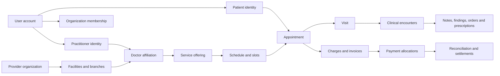

# DocDuniya healthcare marketplace and provider software design

Design baseline: 23 November 2026. Status: proposed architecture for product review. No application code, database migrations, or running infrastructure is created by this design.

DocDuniya connects patients with independent doctors, clinics, and hospitals across India and supplies the software those providers use to run their practices. The architecture therefore has **three distinct responsibilities: marketplace, provider operations, and patient-controlled access to health information**.

Use the existing **Node.js, Express, TypeScript, MongoDB, and Mongoose** backend as a modular monolith. Give every provider an organization boundary; a solo doctor receives a `SOLO_PRACTICE` organization. A doctor can work across several organizations without duplicating their professional identity. Clinical records remain under an explicit custodian, and a platform administrator does not automatically receive clinical access.

## Read the design

| Document                                                                    | Decisions it contains                                                                                         |
| --------------------------------------------------------------------------- | ------------------------------------------------------------------------------------------------------------- |
| [Research and scope](01-research-and-scope.md)                              | Established systems, official standards, gaps in the supplied notes, product boundaries, India assumptions    |
| [HLD and LLD](02-hld-and-lld.md)                                            | Deployment, module ownership, tenant boundaries, Express structure, patterns, architecture decisions          |
| [Workflows and invariants](03-workflows-and-invariants.md)                  | Onboarding through booking, care, payment, sharing, hospital operations, failure handling                     |
| [Core data dictionary](04-data-model-core.md)                               | Marketplace, identity, provider, patient, scheduling, clinical, billing, privacy, and operational collections |
| [Hospital data dictionary](05-data-model-hospital.md)                       | Admission, nursing, laboratory, pharmacy, stock, insurance, and procedure extensions                          |
| [Relationships and MongoDB rules](06-relationships-indexes-and-mongoose.md) | ERDs, embedding choices, uniqueness, indexes, concurrency, Mongoose conventions                               |
| [APIs, security, and events](07-api-security-and-events.md)                 | Command contracts, permissions, data access, event delivery, integration boundaries                           |
| [Operations and roadmap](08-operations-testing-and-roadmap.md)              | Capacity assumptions, production topology, recovery, validation gates, migration, delivery order              |
| [Coverage and decision register](09-coverage-and-decisions.md)              | Requirement traceability, open business choices, design review checklist                                      |

## The central model

## Decisions that change the original draft

1. Keep Express; introduce module boundaries and explicit services rather than changing frameworks.
2. Separate users, patients, practitioners, doctor profiles, organization memberships, and doctor affiliations. They describe different relationships.
3. Permit children, dependents, walk-ins, and unidentified emergency patients without login accounts. Contact information is not a universal patient identifier.
4. Separate the global private identity registry from each organization's registration/MRN and clinical records. Cross-provider history is assembled only from authorized sources.
5. Prevent overlapping reservations across all of a doctor's facilities. A unique index on `doctorId + facilityId + startAt` alone is insufficient.
6. Keep appointment, visit, encounter, payment, invoice, and settlement lifecycles independent.
7. Use immutable signed snapshots and traceable corrections. An editable document version counter is not a clinical revision history.
8. Build privacy, audit, tenant isolation, and recovery before the first clinical release.
9. Treat hospital management as an explicit expansion track; do not mistake a booking marketplace for a complete hospital information system.
10. Keep subscriptions and entitlements separate from roles, care permissions, and clinical record retention.

## Delivery position

The entire ecosystem is mapped here, with a detailed core and named hospital extensions. The recommended first delivery is an end-to-end outpatient marketplace and provider workspace, followed by hospital modules in operationally complete slices. This is a scope recommendation, not a restriction on the product vision.

The data dictionaries define 135 proposed collections: 103 across the marketplace, outpatient, commerce and shared operations domains, and 32 hospital/partner extensions. This is the target inventory across phases, not the minimum launch schema. Each row specifies business fields, types, references and initial constraints/indexes; common field groups are defined once.

The remaining business decisions are listed in [the decision register](09-coverage-and-decisions.md). Chief among them are payment collection and settlement responsibility, launch modules, cancellation/refund policy, supported clinical specialties, and provider contracts. This design is ready for your direction on those choices; implementing schemas remains a separate step.
